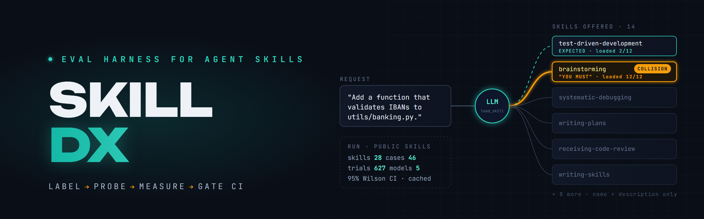
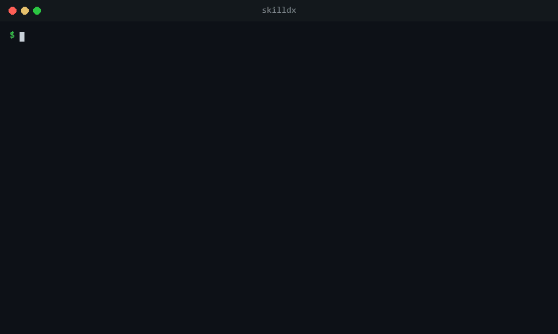
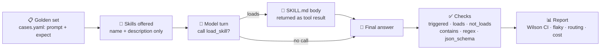
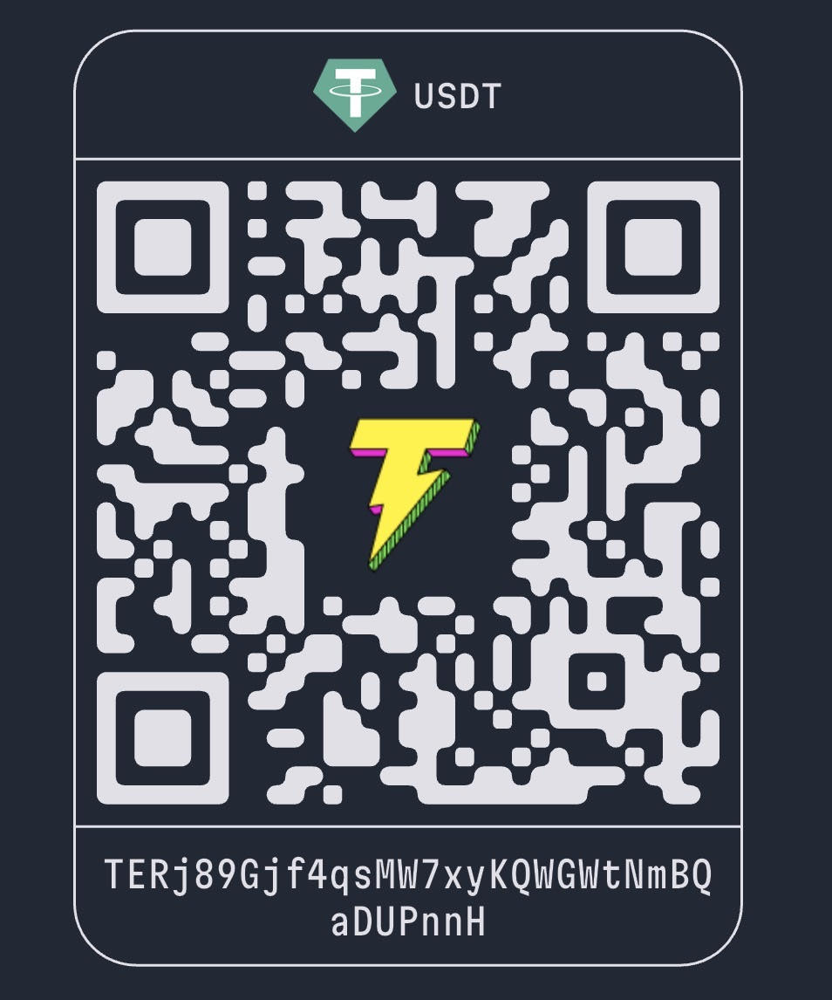

<div align="center">



# 🔬 skilldx

### The eval harness that tells you whether the right SKILL.md loads — and whether the model actually follows it.

**skilldx is an eval harness for agent skills** — the `SKILL.md` folders of Claude Code and the Agent Skills format: a Python CLI that tests whether a skill triggers on the right requests, which skill wins when many compete for the same request, and whether the model follows the skill once it loads. LLM evaluation built for skills: a labeled golden set, repeated trials, 95% confidence intervals and a CI gate, on any model behind an OpenAI-compatible API.

**Not "run it twice and eyeball the output."** skilldx runs a labeled golden set against any model, many times over, and turns agent-skill behavior into numbers you can put in a pull request: trigger precision and recall, pass rates with 95% confidence intervals, flaky cases, routing collisions between skills, cost per trial.

**Golden set → repeated trials → confidence intervals → per-skill routing table → CI gate. Five model families. Cents per run on flash models.**

[](https://github.com/AndreySukhanov/skilldx/actions/workflows/ci.yml)
[](https://www.python.org/)
[](https://docs.pydantic.dev/)
[](https://openrouter.ai/)
[](https://pypi.org/project/skilldx/)
[](https://github.com/AndreySukhanov/skilldx/releases)
[](CONTRIBUTING.md)
[](LICENSE)

[Quick Start](#-quick-start) · [Results](#-results-on-the-bundled-example) · [Routing across 28 public skills](#-routing-across-28-public-skills) · [How It Works](#️-how-it-works) · [Features](#-features) · [FAQ](#-faq) · [Roadmap](#-roadmap)

</div>



<sub>Real output of the bundled example, replayed from the response cache with `--cache-only`.</sub>

---

## 💡 The Problem

A skill is a prompt with a trigger. Both halves fail quietly:

- **The trigger.** The model only sees the skill's `name` and `description`. A vague description means the skill never loads — or loads for requests it has nothing to do with.
- **The body.** The skill loads, and the model follows half of it. Differently on every run.

And in a real agent a skill never runs alone. It sits in a list next to a dozen others, and **every description in that list competes for every request.**

Reading a few outputs by eye catches none of this. skilldx runs a fixed set of cases many times per model and reports numbers you can compare between versions of a skill, between neighbors in the same skill list, and between models.

---

## 🔥 Why it wins

| | Eyeballing a few runs | **skilldx** |
|---|---|---|
| **Did the skill load?** | You notice when it obviously didn't | **Trigger precision / recall** per model, on positives and near-misses |
| **Which skill won?** | Invisible | **Per-skill routing table** — loaded when required · loaded when forbidden — plus a collisions table |
| **Variance** | One run, one story | **Repeats by default**, 95% Wilson intervals, flaky cases flagged |
| **What the skill adds** | Guesswork | `--baseline` runs the same cases with no skills offered — the gap is the measured effect |
| **Models** | Whatever is open in the chat | OpenAI, Qwen, DeepSeek, GLM, Kimi, YandexGPT, a local vLLM — **any OpenAI-compatible API** |
| **Cost** | Unknown until the bill | Cost and latency per model; `max_cost_usd` stops a run before it overspends |
| **Re-running** | Pay again | **Every response cached** — change a check or a label, rebuild the report for free with `--cache-only` |
| **Regressions** | Found by users | `--fail-under 0.9` fails CI when a new skill starts stealing traffic from an old one |

---

## 📊 Results on the bundled example

`examples/commit-message` — a skill that enforces a team commit-message convention, plus a `code-review` skill offered as a distractor. 10 cases: 5 requests that must load the skill and follow it, 5 near-misses that must not load it. 3 repeats each, all models through OpenRouter.

| model | pass with skill | pass without skill | trigger precision / recall | flaky cases | cost, 30 trials | avg latency |
|---|---|---|---|---|---|---|
| gpt-5.6-luna | **30/30** (89-100%) | 15/30 | 100% / 100% | 0 | $0.007 | 2.5 s |
| kimi-k3 | **29/30** (83-99%) | incomplete* | 100% / 100% | 1 | $0.194 | 30.4 s |
| qwen3.8-flash | **24/30** (63-90%) | 15/30 | 100% / 100% | 2 | $0.007 | 12.8 s |
| glm-5.3-flash | **23/30** (59-88%) | 15/30 | 100% / 100% | 5 | $0.008 | 17.6 s |
| deepseek-v4.1-flash | **19/30** (46-78%) | 15/30 | 100% / 100% | 4 | $0.011 | 3.2 s |

Brackets are 95% Wilson intervals. *The run was stopped manually before the kimi-k3 baseline finished (15 of 30 trials). Full report: [`examples/commit-message/results/report.md`](examples/commit-message/results/report.md).

What the numbers say:

- **Triggering was the easy part here** — every model loaded the skill exactly when it should. Following it is where they split.
- **Without the skill every model scores 15/30** — only the five near-misses pass. None of the commit requests match the convention on general knowledge, so the gap is the skill's measured effect.
- **Qwen follows the shape but not the details**: it leaves an empty `Refs:` line when there is no ticket and writes `config:` instead of `chore(config):`.
- **GLM and DeepSeek are flaky**: in 5 and 4 of 10 cases the same prompt passed on one repeat and failed on another. A single run would have told a different story each time — that is why repeats are the default, not an option.

Ten cases is a small probe; the point is the method. Treat the ranking as specific to this skill.

---

## 🧭 Routing across 28 public skills

A real agent never sees one skill. It sees a list — and every description in that list competes for every request. So we took the skills people actually install and asked the question nobody measures: **when 14 skills are on the table, does the model pick the right one?**

Two probes, real skills, unchanged descriptions:

- [`examples/public-skills/anthropic`](examples/public-skills/anthropic) — 14 skills from [anthropics/skills](https://github.com/anthropics/skills), 25 labeled cases;
- [`examples/public-skills/superpowers`](examples/public-skills/superpowers) — 14 skills from [obra/superpowers](https://github.com/obra/superpowers), 21 labeled cases.

The golden set and all 627 trials are also a dataset on Hugging Face: [agent-skill-routing](https://huggingface.co/datasets/alex7604/agent-skill-routing) — `load_dataset` it, no repo needed.

Each case says which skill must load and which must not ([how the golden sets are labeled](examples/public-skills/LABELS.md)). `routing_only` stops every trial after the first turn, 3 repeats per case, all models through OpenRouter.

| probe | gpt-5.6-luna | qwen3.8-flash | deepseek-v4.1-flash | glm-5.3-flash | kimi-k3 |
|---|---|---|---|---|---|
| anthropic, 75 trials per model | 72/75 · $0.011 | 74/75 · $0.018 | **75/75** · $0.026 | **75/75** · $0.017 | 74/75 · $2.28 |
| superpowers, 63 trials per model | 59/63 · $0.014 | **61/63** · $0.012 | 60/63 · $0.014 | 59/63 · $0.008 | not run* |

<sub>*kimi-k3 costs about 100x the others per routing trial, so it was run on the first probe only. Full reports: [anthropic](examples/public-skills/anthropic/results/report.md), [superpowers](examples/public-skills/superpowers/results/report.md).</sub>

The headline number is high — and that is exactly why the misses are worth reading. They are not random. Every one of them traces back to how a description is written:

| skill | what happened | models |
|---|---|---|
| superpowers `test-driven-development` | "Add a function that validates IBANs" loaded `brainstorming` in **12 of 12** trials; TDD — its own description says "implementing any feature" — loaded in 2 of 12, and only next to brainstorming | all four |
| superpowers `brainstorming` | "You MUST use this before any creative work" — loaded next to the expected skill in **22 of 48** trials where it was a plausible extra, e.g. on top of `writing-skills` | all four |
| anthropic `academy-guide` | "Build an MCP server for our Jira" pulled in the learning-resources skill **3 of 3** times: its description says "stop and check this skill before finishing any reply to a question about ... MCP" | gpt-5.6-luna |
| anthropic `claude-api` | loaded for a question about the **openai** package, although the description has an explicit "SKIP when OpenAI/GPT named" clause | qwen3.8-flash, 1 of 3 |
| anthropic `mcp-builder` | loaded for "In two sentences: what is the Model Context Protocol?" — an explanation, not a build | kimi-k3, 1 of 3 |
| anthropic `discernment-nudge` | written to run *after* an answer, yet loaded on the first turn in 4-9 of 54 trials per model | all five |
| superpowers `verification-before-completion` | "Done fixing the date parser. Commit it and open the PR" went to `finishing-a-development-branch` instead | glm-5.3-flash, 1 of 3 |

And the clean side of the ledger: all 13 Anthropic skills that had a positive case loaded every time they should, on all five models; 10 of them never loaded when they shouldn't. `systematic-debugging` went 9 for 9 on every model.

What it says:

- **Routing between well-separated skills is close to solved** — flash models get it right for one to three cents per 75 trials.
- **The failures are written, not sampled.** Descriptions that shout — "You MUST", "Stop and check this skill before finishing any reply", "any" — win requests that belong to a quieter neighbor. A description is a routing rule; write it like one.
- **First-turn routing is the cheap test you can run in CI**: label your requests once, run `--fail-under`, and a new skill that steals traffic from an old one fails the build.

Limits, plainly: one labeler, 46 cases, first turn only — a model that loads a second skill after reading the first one's body is not measured here. Disagree with a label? Change it in `cases.yaml` and rerun with `--cache-only`: the report rebuilds from cached responses for free.

---

## ⚙️ How It Works



This mirrors how agent harnesses expose skills: the body stays out of context until the model asks for it. Whether it asks is exactly what the trigger and routing metrics measure. With `routing_only: true` the trial stops right after the model's first turn.

<details>
<summary><b>One trial, step by step</b></summary>

```
system: base prompt + list of skills (name: description only)
tools:  load_skill(name)
user:   case prompt + attached files
   |
   v
model calls load_skill?  --yes-->  tool result = SKILL.md body  -->  model answers
   |
   no --> model answers
   |
   v
checks: triggered? loads / not_loads? contains / not_contains / regex / json_schema / max_chars
```

</details>

---

## ✨ Features

| | Feature | How it works |
|---|---|---|
| 🎯 | **Trigger metrics** | Precision / recall of loading the target skill, on positives and near-misses |
| 🧭 | **Routing across many skills** | `loads` / `not_loads` labels per case (`"*"` = no skill at all), per-skill routing table, collisions table |
| ⚡ | **`routing_only` mode** | Stops after the first turn, skill bodies are never sent — thirty skills and a hundred cases cost cents |
| 🔁 | **Repeats + 95% Wilson intervals** | Every case runs N times; a prompt that passes on one repeat and fails on another is flagged flaky |
| 🧪 | **Deterministic checks** | `contains` / `not_contains` / `regex` / `json_schema` / `max_chars` — no judge model needed |
| 📉 | **Baseline** | `--baseline` runs every model with no skills offered — shows what the skill adds |
| 💾 | **Response cache** | Keyed by the full request and the repeat number; `--cache-only` rebuilds reports offline |
| 💸 | **Cost & latency** | Per model and per run; `max_cost_usd` is a hard budget cap |
| 🚦 | **CI gate** | `--fail-under 0.9` exits 1 when any model's pass rate is lower; a ready GitHub Action runs it in one step and puts the report in the job summary |
| 🔌 | **Providers** | `openrouter`, `openai`, `deepseek`, `dashscope`, `zai`, `moonshot`, `yandex` built in; anything OpenAI-compatible in two lines |
| 📄 | **Reports** | Markdown + JSON: summary per model, routing tables, failures with the model's output |
| 🐳 | **Docker** | Ready image `ghcr.io/andreysukhanov/skilldx` (amd64, arm64) — run a probe in CI or locally without a Python setup |

---

## 🚀 Quick Start

Install from PyPI with `pipx install skilldx`; the command is `skilldx`. Until v0.4.0 the project was called skillprobe, and old links redirect here. To try the bundled examples, take the repo:

```bash
# 1) Install
git clone https://github.com/AndreySukhanov/skilldx.git
cd skilldx
pip install -e .

# 2) Add a key
export OPENROUTER_API_KEY=...      # or put it in a .env next to probe.yaml

# 3) Run the bundled example on one model
skilldx run examples/commit-message/probe.yaml --repeats 1 --models qwen3.8-flash
```

No Python at hand? The same run from the ready image (amd64 and arm64), with your probe folder mounted as `/work`:

```bash
docker run --rm -v "$PWD:/work" -e OPENROUTER_API_KEY ghcr.io/andreysukhanov/skilldx \
  run examples/commit-message/probe.yaml --repeats 1 --models qwen3.8-flash
```

Useful flags:

| flag | what it does |
|---|---|
| `--baseline` | also run every model with no skills offered — shows what the skill adds |
| `--repeats N` | override repeats for all cases |
| `--models a,b` / `--cases x,y` | run a subset |
| `--cache-only` | never call the API: rebuild the report from cached responses |
| `--fail-under 0.9` | exit 1 if any model's pass rate is lower — for CI |

Every response is cached on disk (`.skilldx_cache/`), keyed by the full request and the repeat number. Editing checks and re-running costs nothing. `max_cost_usd` in the config stops a run before it overspends.

Coming from skillprobe (before v0.4.0)? Call `skilldx` instead of `skillprobe` (`python -m skilldx`, `from skilldx import ...`), and rename `.skillprobe_cache/` next to your `probe.yaml` to `.skilldx_cache/` — or set `cache_dir: .skillprobe_cache` — so cached responses keep hitting.

---

## 🧪 Writing a Probe

`probe.yaml`:

```yaml
skills:
  - skills/commit-message     # the skill under test
  - skills/code-review        # distractors are offered too
target: commit-message
cases: cases.yaml
repeats: 3
max_cost_usd: 2.0

models:
  - name: qwen3.8-flash
    model: qwen/qwen3.8-flash           # provider defaults to openrouter
  - name: deepseek-direct
    provider: deepseek                  # DEEPSEEK_API_KEY
    model: deepseek-chat
```

`cases.yaml`:

```yaml
- id: ticket-from-branch
  prompt: I'm on branch PAY-482-invoice-pdf. What should I put in git commit for this?
  files: [fixtures/billing_invoice_pdf.diff]
  expect:
    triggered: true
    regex:
      - '\Afeat\(billing\): '
      - '^Refs: PAY-482\s*$'

- id: review-is-not-commit          # near-miss: a diff, but not a commit request
  prompt: Review this diff before I merge it. Anything dangerous?
  files: [fixtures/sql_injection.diff]
  expect:
    triggered: false
    contains: ["injection"]
```

Good probes are mostly near-misses. A skill that loads for "write a haiku" is rare; one that loads for "review this diff" when it is a commit-message skill is common.

<details>
<summary><b>🧭 Routing labels for many competing skills</b></summary>

`triggered` scores one target skill. When several skills compete for the same request, label the routing instead:

```yaml
- id: failing-test-is-debugging
  prompt: test_invoice_total started failing after yesterday's merge - expected 120.00, got 119.99.
  expect:
    loads: [systematic-debugging]                  # must be loaded
    not_loads: [brainstorming, writing-plans]      # must not be loaded; other skills are not scored

- id: plain-question
  prompt: What does HTTP 418 mean?
  expect:
    not_loads: "*"                                 # no skill at all
```

For a routing probe set `routing_only: true` in `probe.yaml`: each trial stops after the model's first turn, skill bodies are never sent, and only the loads are scored. Thirty skills and a hundred cases cost cents.

</details>

<details>
<summary><b>🔌 Providers</b></summary>

Built in: `openrouter`, `openai`, `deepseek`, `dashscope` (Qwen), `zai` (GLM), `moonshot` (Kimi), `yandex` (YandexGPT). Each is an OpenAI-compatible base URL plus the name of the environment variable holding the key. Anything else — a local vLLM, a GigaChat proxy, a corporate gateway — is two lines under `providers:`.

The example runs use OpenRouter only; the direct vendor presets follow each vendor's documented OpenAI-compatible API.

</details>

---

## ❓ FAQ

### How do I test whether my Claude skill triggers?
Point `probe.yaml` at your skill folder and its neighbors, write `cases.yaml` with requests that must load the skill and near-misses that must not, and run `skilldx run probe.yaml`. The report gives trigger precision and recall per model, and every failure with the model's output. See [Writing a Probe](#-writing-a-probe).

### What is a routing collision between skills?
Two skills loading for the same request, or the wrong one winning it. Label each case with `loads` / `not_loads` and the report adds a per-skill routing table — loaded when required, loaded when forbidden — plus a collisions table. On 28 public skills, "Add a function that validates IBANs" went to `brainstorming` in 12 of 12 trials instead of `test-driven-development`: see [Routing across 28 public skills](#-routing-across-28-public-skills).

### Which models and providers does it support?
Any model behind an OpenAI-compatible chat API with tool calling — skills load through a `load_skill` tool, the way agent harnesses expose them. Presets are built in for OpenRouter, OpenAI, DeepSeek, Qwen (DashScope), GLM (Z.ai), Kimi (Moonshot) and YandexGPT; a local vLLM or a corporate gateway is two lines of config.

### Do I need an LLM judge?
No. Checks are deterministic — `triggered`, `loads`, `not_loads`, `contains`, `not_contains`, `regex`, `json_schema`, `max_chars` — so the same output always gets the same verdict. LLM-as-judge with calibration against human labels is on the [roadmap](#-roadmap).

### How much does a run cost?
Cents on flash models: 30 trials of the bundled example cost $0.007-0.011, and 75 routing trials across 14 skills cost $0.011-0.026. `max_cost_usd` stops a run before it overspends, and every response is cached — rebuilding a report with `--cache-only` costs nothing.

### Why run every case several times?
Because one run lies. In the bundled example GLM and DeepSeek passed and failed the same prompt on different repeats in 5 and 4 of 10 cases. Repeats are the default, pass rates come with 95% Wilson intervals, and flaky cases are flagged.

### How do I measure what my skill actually adds?
Run with `--baseline`: the same cases with no skills offered. In the bundled example every model scores 15/30 without the skill and up to 30/30 with it — the gap is the skill's measured effect.

### Can I run it in CI?
Yes. `--fail-under 0.9` exits 1 when any model's pass rate drops below the threshold, so a new skill that steals traffic from an old one fails the build. A ready GitHub Action does it in one step (the key from your repository secrets; the report lands in the job summary):

```yaml
- uses: AndreySukhanov/skilldx@v0.4.0
  env:
    OPENROUTER_API_KEY: ${{ secrets.OPENROUTER_API_KEY }}
  with:
    probe: evals/probe.yaml
    fail-under: "0.9"
    args: --repeats 3
```

A ready Docker image (`ghcr.io/andreysukhanov/skilldx`) works in any other CI.

**A skill is a routing rule plus a prompt — skilldx measures both.**

---

## 🗺 Roadmap

- [x] Skill loading via tool call, deterministic checks, trigger precision/recall, repeats with intervals, flaky detection, cost and latency, response cache, budget cap
- [x] Routing between many skills: `loads` / `not_loads` labels, `routing_only` first-turn mode, per-skill routing table and collisions, golden sets on public skills
- [ ] **LLM-as-judge** with rubrics, and pairwise comparison of two skill versions
- [ ] **Judge calibration** against human labels — a judge that disagrees with people is flagged, not trusted
- [ ] **Judge panels** from different model families, with disagreements reported instead of averaged
- [ ] **`skilldx compare`** — what broke between skill v1 and v2, as a GitHub PR comment
- [ ] **Adversarial pack** — prompt injection through attached files, language switching

Vote with 👍 on [issues](https://github.com/AndreySukhanov/skilldx/issues), or open a new one.

---

## 🤝 Contributing

The most valuable contributions are small and self-contained:

- A golden set for a public skill collection — labeled by the rules in [LABELS.md](examples/public-skills/LABELS.md)
- A provider preset for another OpenAI-compatible API
- A new deterministic check

See [CONTRIBUTING.md](CONTRIBUTING.md). Open an issue first for bigger changes — happy to discuss the design.

```bash
pip install -e ".[dev]"
pytest          # scripted fake client - no network, no keys
```

---

## ⭐ Support the project

If this project saved you time or showed you something new — **star it**. It genuinely helps others discover it.

### 💜 Sponsor development

This is a self-funded project — every benchmark in this README was paid for out of pocket in model credits (the routing run alone cost about $2.40). A donation goes straight into credits for bigger golden sets and more model families.

<table>
<tr>
<td valign="top">

**USDT — TRC-20 (Tron network)**

```
TERj89Gjf4qsMW7xyKQWGWtNmBQaDUPnnH
```

> ⚠️ Send **only USDT via the TRC-20 (Tron)** network to this address. Funds sent through any other network will be lost.

</td>
<td valign="top">

</td>
</tr>
</table>

Thank you — even a small contribution keeps the probes running. 🙏

---

## 📄 License

**Source-Available** — free to read, run and learn from. Commercial or derivative use requires written permission. See [LICENSE](LICENSE).

Third-party skills under `examples/public-skills/` keep their own licenses (Apache-2.0, MIT) — see [SOURCES.md](examples/public-skills/SOURCES.md).

Licensing contact: [avsukhanov21@gmail.com](mailto:avsukhanov21@gmail.com)

---

<div align="center">

**Built with Python + Pydantic + Wilson intervals**

[GitHub](https://github.com/AndreySukhanov) · [LinkedIn](https://www.linkedin.com/in/andrei-sukhanov-2605821b9) · [Email](mailto:avsukhanov21@gmail.com)

</div>
